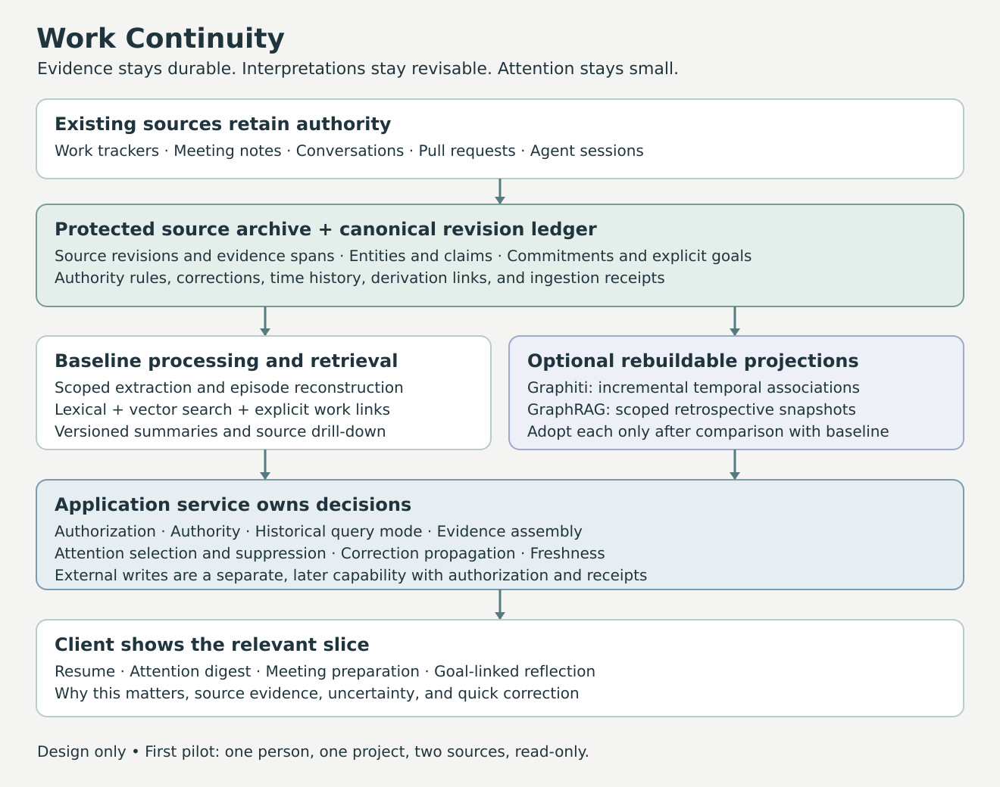

# Work Continuity

A design for an evidence-grounded assistant that helps people capture commitments, resume interrupted work, and notice unresolved follow-ups without maintaining another sprawling task system.

**Status: design and synthetic fixtures only. There is no assistant implementation or working integration in this repository.** Research and upstream source inspection: October 30, 2026.

The proposed system connects existing trackers, meeting notes, conversations, pull requests, and agent sessions. It preserves evidence and its history, connects records about the same work, and presents a small amount of useful context at the right moment. Longer-term applications include reflection against explicit developmental goals and advice about personal projects. Work and personal deployments remain separate by default.

## Main design decisions

- Existing systems retain authority over the work state they own. The assistant records interpretations separately.
- Original records, reconstructed episodes, inferred claims, and explicit user direction have different semantics.
- A local archive and revision ledger support replay, corrections, and source citations. Search indexes and graphs are rebuildable projections.
- Start with a relational ledger, lexical and vector retrieval, and explicit work links. Evaluate **Graphiti** as the first optional temporal-memory backend. Evaluate **Microsoft GraphRAG** later for broad retrospective questions.
- Hierarchical summaries provide navigation at different levels of detail. They never become the only route to original evidence.
- The default interface shows a few commitments and resumption cards, with small relevant subgraphs available on demand.
- The first pilot is read-only. External actions are a separately authorized feature with explicit destinations, preconditions, and receipts.



## Read the design

| Document | Purpose |
| --- | --- |
| [System design](docs/design.md) | Product behavior, architecture, memory model, time, authority, correction, retrieval, and attention |
| [Research and foundation choices](docs/research.md) | What GraphRAG, Zep/Graphiti, RAPTOR, and LongMemEval contribute; source-level integration boundaries |
| [Integration and data contracts](docs/contracts.md) | Records, connector capabilities, client API, consistency, and optional writeback |
| [Evaluation plan](docs/evaluation.md) | Baselines, failure diagnosis, temporal replay, security cases, and pilot gates |
| [Implementation plan](docs/implementation-plan.md) | Build order, deliverables, decision gates, and workplace discovery checklist |
| [Synthetic scenario](examples/scenario.json) | A fictional investigation linking notes, tracker state, PR evidence, corrections, and late events |

Start with the system design, then the research comparison. At implementation time, use the contracts and milestone gates together.

## Retrieve and check

```sh
git clone https://github.com/bearbones/work-continuity.git
cd work-continuity
python3 scripts/check_docs.py
```

The check validates repository links, JSON fixture references, and basic temporal consistency. It does **not** evaluate a memory engine or establish that the proposed integrations work.

## Public repository boundary

This repository contains generic design material, public references, and invented examples. Keep workplace archives, real identifiers, meeting notes, credentials, evaluation answers derived from company records, and operational databases in an appropriately controlled implementation environment outside this public checkout. The client and connector contracts deliberately avoid assumptions about any particular internal tool.

Licensed under [MIT](LICENSE). Upstream libraries retain their own licenses; no upstream source or paper text is vendored here.
