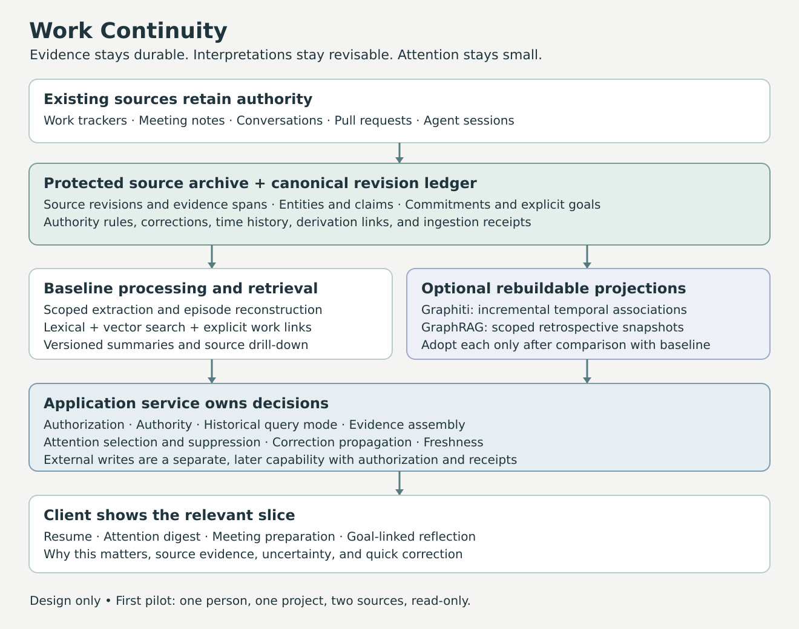

# System design

## Purpose and first useful outcome

Work Continuity reduces the effort required to remember commitments and reestablish context across fragmented work. The first useful outcome is a short, evidence-backed view that helps a person resume an investigation or catches a dropped follow-up. The amount of information stored is not a success metric.

The initial deployment serves one person, one project, one tracker, and one source of notes or agent sessions over roughly four to six weeks. A small client integrates into an existing work interface. A complete graph visualization is not the primary interface.

The same memory infrastructure can later support three distinct applications:

1. **Continuity and attention:** identify relevant open commitments, explain why a new event matters, and preserve where work stopped.
2. **Developmental reflection:** compare observed episodes with explicitly stated goals, with counterexamples and archive coverage visible.
3. **Personal exploration:** suggest project directions and learning opportunities using revisable preferences, present interests, and constraints.

These applications share retrieval and evidence handling. They do not share a single ranking policy, and they do not automatically share data.

## Requirements and non-goals

The assistant must answer “why are you showing this?”, “where did that come from?”, “was that true then or now?”, and “what changes if I correct this?” It must tolerate missing integrations, incomplete archives, ambiguous owners, uncertain dates, and work completed outside the available systems.

Every material factual assertion in a card or answer must resolve to authorized source revisions or an explicit user declaration. Unsupported interpretations must be labeled as hypotheses. A source containing a statement proves that the statement occurred; it does not automatically prove its subject matter.

Initial non-goals are autonomous dispatch, replacing the organization's tracker, exhaustive task extraction, a company-wide knowledge graph, employee assessment, and reconstructing a personality from activity logs. No diagnostic or therapeutic claims are made about the product. The interaction design is intended to reduce memory and coordination effort.

## User experience

### Small views chosen for a situation

The client supports four entry points:

- **Resume:** current objective, last verified state, last attempted approach, next suggested step, and unresolved assumptions.
- **Attention:** a few events with a concrete connection to an active commitment, dependency, or user-selected watch rule.
- **Meeting preparation:** open follow-ups involving the meeting participants, changed evidence, and decisions awaiting discussion.
- **Reflection:** observations related to a selected goal over a stated interval, with supporting and contradicting episodes.

A card contains a short title, why it matters now, known status and its source, a suggested next step, source links, and freshness. “Suggested” must remain visibly different from “committed.” Expanding a card reveals evidence and relevant relationships. A local subgraph starts with the focal commitment and a few immediate dependencies; the user can expand it with explicit truncation indicators.

Actions include open source, pin, snooze until a time or event, dismiss this suggestion, correct an interpretation, and optionally propose a tracker update. Dismissing a card does not complete a task. Snoozing does not change its deadline. Reading a card does not acknowledge or accept a commitment.

### Burden control

Begin with on-demand views and a digest. An initial configurable default is at most three visible attention cards, with the rest available on request. This number is a product hypothesis, not a research result. Notification limits, quiet hours, channels, and escalation conditions belong to explicit user configuration.

Questions are reserved for ambiguity that changes an imminent decision. The system can keep an uncertain owner or unresolved duplicate without immediately adding a review task. User corrections should take one short interaction and persist across reprocessing.

“No observed progress” must include the observation window and source coverage. It must never silently mean “no progress happened.” A failed connector causes a freshness warning, not an overdue-work accusation.

## Architecture

The default implementation has four durable components and two optional projections:

1. **Source archive:** versioned, policy-permitted payloads and normalized text in a local protected data directory. Large artifacts remain referenced by stable locations and hashes when copying is unnecessary or prohibited.
2. **Canonical ledger:** source identities and revisions, evidence spans, entities, claim versions, work references, user direction, corrections, ingestion receipts, and action receipts. Use a relational database initially.
3. **Retrieval projection:** lexical index, embeddings, explicit graph adjacency, and compact summaries. These can be regenerated from authorized retained inputs and versioned processing outputs.
4. **Application service:** access checks, authority policy, temporal query planning, context assembly, attention selection, and the client API.
5. **Optional Graphiti projection:** incremental semantic entity and relationship retrieval behind the same application interfaces.
6. **Optional GraphRAG snapshot:** scope-specific community summaries and broad retrospective retrieval.

The ledger is the assistant's durable record, not a replacement for the authoritative upstream tracker. Graph backends may propose semantic associations but cannot directly mutate commitments or user direction.

An archive is append-oriented within retention policy, not undeletable. Deletions, changed access, and corrections have different semantics and must reach derived data. See [contracts](contracts.md).

## Memory and work model

### Source records

A source record is a message, note, issue, PR revision, agent turn, tool result, or other addressable object. Each revision preserves identity, origin, author or actor type, timestamps, access scope, parent/thread relationships, normalized content, and provenance. Edits create new revisions rather than rewriting historical evidence in place.

Do not strip an agent transcript down to its final answer. Preserve user requests, assistant claims, tool calls, tool results, errors, and artifacts as distinct roles. The phrase “all tests passed” in generated prose is weaker completion evidence than the corresponding test receipt. A test receipt itself only supports the actual test, configuration, and revision it covers.

### Episodes

An episode is an application-level reconstruction of a coherent activity: investigating a failure, deciding on an approach, implementing a change, handing off ownership, or agreeing a follow-up. It links several source records without losing their identities. An episode can remain open and gain new revisions.

Keep a minimal structured account: objective, participants, time range, attempts, decisions, outcomes, unresolved questions, and evidence references. Missing outcomes stay missing. The last message is not assumed to be the conclusion.

An application episode is not necessarily a Graphiti episode. The latter can be a single ingestion unit. Preserve an explicit mapping so regrouping an investigation does not require pretending that the original messages changed.

### Claims and interpretations

A claim is an attributed proposition with evidence and scope, such as “the investigation is blocked on a benchmark” or “earlier consultation may have reduced rework.” It records who asserted it, how it was produced, and whether it is reported, inferred, verified for a particular purpose, disputed, superseded, or retracted.

Separate three questions:

- **Extraction:** did the source actually express this proposition?
- **Truth or current validity:** is there evidence that it holds in the relevant scope and time?
- **Authority:** is this source permitted to establish the field being asked about?

A single model-generated confidence score cannot answer all three. Use categorical status and explicit evidence first; any probabilities must be calibrated against labeled examples before driving automation.

Summaries and repeated assistant paraphrases do not provide independent corroboration. Track an origin family for copied or derived records, and count independent evidence families rather than citations.

### Entities, commitments, and relationships

Start with Person, Project, Objective, WorkItem, Artifact, Decision, and Goal. Use stable external identifiers where possible. Project names and display names are aliases, not identity keys. Cross-system identity merges require explicit links, authoritative mappings, or a reversible accepted proposal.

A commitment references its authoritative work record where one exists. It can also begin as a provisional candidate extracted from notes. A candidate is not a task assigned by the assistant. Its fields include intended outcome, owner, lifecycle state, due or review time if present, dependencies, and source evidence.

Use a small typed relationship vocabulary: `part_of`, `depends_on`, `implements`, `supports`, `contradicts`, `supersedes`, `owned_by`, `follow_up_to`, and `related_to`. Keep broad semantic similarity in a separate index; similarity alone does not establish a dependency.

Hierarchical parents must be acyclic if the upstream model requires a tree. Dependency graphs may contain cycles; surface the cycle and use visited sets in traversal. Never silently drop nodes to make a graph look clean. Record traversal limits and omitted counts in API responses.

### Explicit direction

Store goals, priorities, watch rules, notification preferences, and current constraints as versioned user declarations. Inferred preferences can be suggested for adoption but cannot overwrite explicit direction. Expired goals remain useful historically without automatically ranking current work.

History describes where attention went. It does not establish where the person wants attention to go next.

## Authority and reconciliation

Authority is assigned per field and scope, not by declaring one application universally correct.

| Field | Example designated home | Other records contribute |
| --- | --- | --- |
| Work-item lifecycle | Tracker owning that work item | Evidence of a possible mismatch |
| PR merge state | Code-host PR record | Context about intent and consequences |
| Objective owner | Configured objective tracker | Handoff evidence and disputed alternatives |
| Personal developmental goal | User declaration | Related episodes and observations |
| Meeting follow-up | Configured notes/tracker record or provisional ledger entry | Supporting artifacts and reminders |

When a note, tracker item, and PR refer to the same commitment, associate them with one logical item. Do not create three synchronized tasks. If a dedicated lightweight tracker project is used for otherwise untracked commitments, it becomes the designated home for those commitments only.

A tracker can act as an accessible shared work graph through its objects and links. It should not be assumed to provide a general temporal database, fine-grained claim provenance, or the assistant's search operations. Those capabilities must be assessed through an adapter; the local projection supplies missing retrieval structure.

A merged PR can supply completion evidence without closing an investigation whose acceptance criterion includes rollout verification. On a mismatch, show both observations and suggest reconciliation. Later optional writeback rereads the source and uses optimistic concurrency.

## Temporal semantics

Keep these times distinct:

- `occurred_at`: when the source event happened, if known.
- `source_updated_at`: when the upstream object revision changed.
- `observed_at`: when this deployment received it.
- `valid_from` and `valid_to`: the interval to which a claim applies in the world, possibly unknown.
- `recorded_from` and `recorded_to`: the interval during which a particular claim revision was the assistant's recorded interpretation.
- `due_at`: a commitment deadline; it is not the end of a fact's validity.

Use UTC instants with original timezone and date precision retained. Resolve relative phrases against the message's time and locale, not ingestion time. “Next week” can remain an interval. Do not invent midnight precision or use a guessed deadline to invalidate a commitment.

Intervals use inclusive starts and exclusive ends. Unknown boundaries require explicit unknown markers; they must not be silently equated with infinite certainty. Current authoritative snapshots can establish present state without establishing when that state began.

Two historical questions require different query modes:

1. **World as of T, using knowledge available now:** use the latest retained claim revisions about T, including later corrections.
2. **What the assistant knew at K about world time T:** restrict source observations and claim revisions to knowledge available at K, then apply validity at T.

The second mode is necessary for faithful event replay. A May import of an April handoff cannot influence a simulated April notification. A regenerated summary containing that handoff cannot be used either, even if it cites older sources. Use a historical projection or source-constrained reconstruction. Access is always checked against the current requester's permissions; a historical query does not restore revoked access.

Late, out-of-order, and backfilled events trigger reconciliation by source revision and effective time. Arrival order alone never establishes authority. Contradictory claims can coexist while scope and evidence are resolved.

## Ingestion and correction

### Processing sequence

1. Fetch changed objects, edits, deletions, and access changes using connector capabilities.
2. Validate identity and scope; store the permitted source revision and durable ingestion receipt.
3. Queue normalization and extraction with an idempotency key derived from source revision and processing version.
4. Extract explicit fields deterministically before asking a model to interpret prose.
5. Provide same-thread context, authorship, timestamps, and source role to the extraction model.
6. Resolve entities conservatively; persist candidate claims and evidence spans.
7. Apply authority, temporal, correction, and scope rules in application code.
8. Update disposable indexes, affected episodes, and summaries; enqueue affected attention candidates.
9. Publish a projection watermark so clients know how far processing has progressed.

Only advance the connector cursor after the source revision and downstream work item are durable. The worker can fail and retry without losing the event. A source cursor and a completed projection watermark are separate values.

### Extraction constraints

The extraction prompt requests proposals, decisions, commitments, observed outcomes, explicit uncertainty, and supporting spans. It forbids inventing owners, deadlines, success, or causal conclusions. Parsed structured output must satisfy the schema and reference real spans. A citation's existence is validated mechanically; whether it supports the claim needs a separate semantic check or human evaluation.

Source text is data, including text that contains instructions to an assistant. Retrieved instructions cannot change tool permissions, retention policy, authority mappings, or output destinations. Extraction workers do not have external write credentials.

### Corrections and dependency invalidation

Maintain a derivation graph from source revisions through claim revisions, episode summaries, topic summaries, and attention items. A correction creates a durable override with a reason and scope; it does not rewrite a source message to say something else.

For example, “this PR implemented the fix, but the rollout is unverified” retracts a derived completion claim. The affected resumption card and retrospective statement are marked stale immediately. Regeneration uses the correction as an input. The rejected interpretation must not reappear during the next reindex.

On deletion or lost access, first make affected content unavailable to retrieval and display, then remove or rebuild derived material. A summary that combines permitted and revoked sources cannot be served unchanged. Keep only policy-permitted minimal tombstone metadata. On ordinary factual correction, preserved history can explain earlier beliefs; on required erasure, content must not survive in that history.

## Retrieval and the multiscale index

### Navigation levels

The proposed pyramid has four useful levels: a sparse topic directory, short topic/project descriptions, episode accounts, and source passages. Topic pages can link horizontally and can belong to multiple views. A project hierarchy, a timeline, and a thematic grouping are separate navigational projections over overlapping evidence.

Each summary records its inputs, model/prompt version, scope, time window, knowledge cutoff, and freshness. Generated community IDs are internal index identities and may change during rebuilds; stable user-facing topics use application IDs.

The pyramid helps allocate attention and context. Direct lexical, semantic, identifier, and temporal retrieval remain available at every level. A bad root summary must not hide an entire investigation.

### Query plan

The application first determines purpose, requesting principal, scope, focal work items, world time, knowledge cutoff, and budget. Explicit identifiers and structured filters bypass semantic discovery where possible.

For a local question, combine exact links, lexical matches, vector candidates, and a bounded graph neighborhood. Deduplicate by source and origin family, rerank candidates, recover evidence passages, and include relevant contradictions. The resulting context contains authority labels, time qualifiers, gaps, and freshness alongside text.

For a broad question, select project/time slices and obtain topic or community summaries to identify candidate themes. Drill back into supporting episodes, sample counterexamples, and distinguish counts over the complete authorized slice from examples retrieved by relevance. A top-k search result is not a valid denominator for “most of your work.”

For current-status questions, read the authoritative projection and refresh upstream when freshness matters. Do not ask a similarity search to determine whether an issue is open.

An initial retrieval budget might gather 30 candidates per enabled method, expand two graph hops, and assemble up to 8,000 evidence tokens. These are configurable starting values to tune under evaluation. Required evidence and unresolved contradictions take priority over decorative summaries. Report truncation and abstain or narrow the answer if the budget cannot support the requested scope.

### Answer construction

The context packet distinguishes source assertions, accepted current state, and hypotheses. The answering model receives no external action privileges. Each material conclusion returns evidence IDs. Validate that IDs exist, are accessible, match the temporal mode, and support the stated type of conclusion. A second model can assist validation but is not a substitute for labeled evaluations.

If evidence is insufficient, answer the narrower supported question and name the gap. A system that cannot establish completion should say what is verified and what remains unknown.

## Attention policy

Event relevance and notification worthiness are different decisions. An event can be relevant enough to update memory while being too weak or repetitive to interrupt the person.

First apply eligibility gates: authorized scope, active user relationship or watch rule, fresh-enough state, unsuppressed item, and a usable reason. Then rank using explicit priority, deadline proximity, dependency impact, new information, actionability, and user context. Penalize uncertain ownership, weak evidence, stale data, and recent duplicate notifications. Never interpret graph degree or message volume as personal importance.

Start with inspectable rules rather than an opaque learned score. A review request on an explicitly watched critical interface outranks an unrelated discussion mentioning the same project. A stale commitment may belong in a weekly review while a newly unblocked next step belongs in Resume.

Use a semantic notification identity based on commitment, reason, and evidence change. Multiple source events about one PR should coalesce into one attention item. Snooze state records a time or trigger. Escalation requires an explicit rule; repeated silence is not consent to increase pressure or contact others.

Suggested actions can include “review the linked change,” “check whether rollout validation happened,” or “resume from this command and its observed result.” Do not manufacture urgent deadlines or infer availability from a quiet calendar.

## Reflection and personal exploration

Reflection begins with a user-selected goal and an observation period. Retrieve episodes relevant to the goal, seek counterexamples, report source coverage, and phrase behavioral patterns as testable observations. Distinguish individual contributions from team outcomes. Do not equate number of PRs, messages, or logged hours with impact.

The user can mark an observation inaccurate, irrelevant to the goal, or useful but incomplete. Those are different feedback signals. A dismissed observation must not silently become a lasting personality attribute.

Personal exploration uses a separate corpus and explicit current constraints such as available time, desired novelty, and appetite for finishing versus experimenting. Offer reasons tied to evidence while leaving room for new interests. Cross-domain transfer, if desired, uses an explicitly selected and reviewed abstract preference rather than copying workplace records into a personal assistant.

## Operations and deployment

For the first implementation, use one application process, a durable database-backed queue, a local protected archive, and a relational ledger. SQLite is a reasonable single-user starting proposal; use a server database when concurrency and organizational deployment require it. Exact database, embedding provider, and model selection are implementation decisions to validate in the target environment.

Keep connector, extraction, retrieval, and attention jobs independently retryable. Record model and prompt versions, input hashes, output validation status, token use, wall time, and failure category without putting raw sensitive content into general logs. A provider outage must leave existing verified context accessible and label stale projections.

Optional Graphiti and GraphRAG services must not share a write path into the canonical ledger. Use generation IDs, projection checkpoints, and an atomic active-generation switch. If a projection update partially fails, queries use the last complete generation plus a freshness marker or fall back to direct evidence retrieval.

Backups cover retained source records, corrections, user direction, and action receipts. Test restoration and replay with pinned extraction outputs; rerunning a nondeterministic model is not bit-for-bit reproduction. Record the outputs needed to explain previous decisions within retention policy.

Future multi-user support requires authorization before retrieval, embedding use, summarization, reranking, and generation. Partitions are useful but not an access-control system by themselves. Private meeting notes must not influence a shared summary merely because the summary omits the note's citation.

## Design decisions to preserve

The evidence/interpretation boundary, per-field authority, temporal replay, correction propagation, and low-burden interface are application invariants. Backend choice is intentionally reversible. The [research comparison](research.md) describes concrete adoption paths; the [evaluation plan](evaluation.md) determines whether additional graph infrastructure earns its cost.
